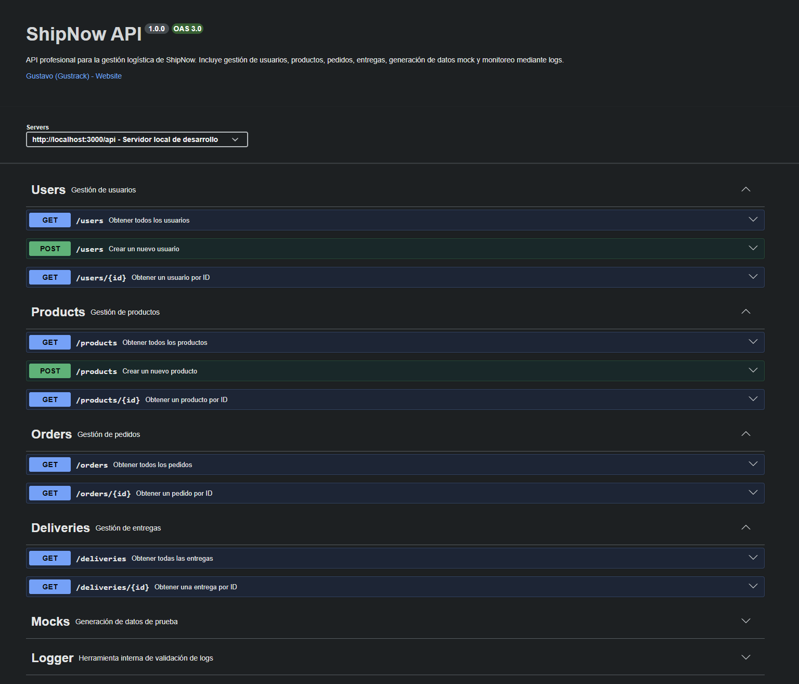

# ShipNow API

API profesional para la gestión logística de ShipNow. Desarrollada como proyecto integrador para el curso de **Programación Backend III (Testing y Escalabilidad)** de Coderhouse.

El proyecto evoluciona a través de 8 pre-entregas, incorporando progresivamente arquitectura por capas, configuración validada, mocking de datos, manejo centralizado de errores, logging, documentación, testing automatizado y carga de archivos.

## Tecnologías Utilizadas

- **Node.js** & **Express** (Servidor y rutas)
- **MongoDB** & **Mongoose** (Base de datos y ODM)
- **Dotenv** (Manejo de variables de entorno)
- **@faker-js/faker** (Generación de datos mock)
- **Winston** & **winston-daily-rotate-file** (Logging profesional y rotación de archivos)
- **Swagger UI** & **OpenAPI 3.0** (Documentación interactiva)
- **Mocha**, **Chai** & **Supertest** (Testing funcional)
- **Multer** (Carga y gestión de archivos)

## Requisitos Previos

- Node.js 18+
- MongoDB local (o URI de MongoDB Atlas)

## Instalación y Ejecución Local

1. **Clonar el repositorio:**

   ```bash
   git clone https://github.com/Gustrack/shipnow.git
   cd shipnow

   ```

2. Instalar dependencias:

```bash
npm install
```

3. Configurar variables de entorno:
   Copiá el archivo de ejemplo y editá los valores reales:

```bash
cp .env.example .env
# En Windows PowerShell: Copy-Item .env.example .env
```

Asegurate de tener MongoDB corriendo localmente o configurar una URI de Atlas en MONGODB_URI.

4. Levantar el servidor:

```bash
npm start
# O en modo desarrollo con auto-reload: npm run dev
```

El servidor estará escuchando en http://localhost:3000.

# Documentación de la API (Swagger)



La API cuenta con documentación interactiva donde podés consultar y probar todos los endpoints en vivo.

1. Levantá el servidor (npm start).
2. Abrí tu navegador y andá a: http://localhost:3000/api/docs
3. Desplegá cualquier endpoint y usá el botón "Try it out".

# Módulos documentados:

- Users: Listado, búsqueda y creación de usuarios.
- Products: Listado, búsqueda y creación de productos.
- Mocks: Generación de datos falsos en memoria y carga de datos de prueba en DB.
- Logger: Endpoint de prueba interna para validar los niveles de Winston.
- Uploads: Carga de documentos de usuario (multipart/form-data).

# Schemas reutilizables:

La documentación incluye schemas de User, Product, Order, Delivery, SuccessResponse y ErrorResponse. Todos los errores documentados reflejan la estructura uniforme implementada en el manejo centralizado de errores.

# Ejecución de Tests (Módulo 6)

El proyecto cuenta con una suite de tests funcionales automatizados para garantizar la estabilidad de la API.

## Herramientas

- Mocha: Organización y ejecución de tests.
- Chai: Aserciones y validación de respuestas.
- Supertest: Simulación de peticiones HTTP sin levantar un servidor real.

## ¿Cómo ejecutar los tests?

1. Asegurate de tener MongoDB corriendo.
2. En la terminal, ejecutá:

```bash
npm test
```

## Entorno de Testing

Los tests se ejecutan con NODE_ENV=test. Las variables de entorno específicas están en el archivo .env.test (el cual apunta a una base de datos separada llamada shipnow_test, manteniendo intactos tus datos de desarrollo).

### Módulos cubiertos por los tests

- Users: Listado correcto, manejo de roles inválidos, creación exitosa y errores de validación.
- Mocks: Generación exitosa, validación de cantidad negativa y no numérica, carga exitosa en DB.
- Logger: Endpoint de generación de logs.
- Swagger: Disponibilidad de la interfaz de documentación.
- Global Errors: Rutas inexistentes y recursos no encontrados (404).
- Uploads: Carga exitosa de archivos, error por archivo faltante, tipo de documento inválido y usuario inexistente.

## Estrategia de limpieza

Antes de ejecutar los tests, la suite se conecta a la DB de testing y limpia las colecciones (ej. User.deleteMany({})) para asegurar que los datos son controlados, repetibles y no dependen del estado previo. Además, al finalizar los tests de uploads, se eliminan los archivos generados en la carpeta uploads/users.

# Módulo 7: Carga de Archivos y Documentos

Se incorporó la carga de archivos utilizando Multer, con configuración centralizada y almacenamiento en disco (no en base de datos).

## Configuración de Multer

- Tipos permitidos: PDF, JPG, PNG.
- Tamaño máximo: 5 MB.
- Carpeta de destino: uploads/users/ (para documentos de usuario).
- Nombres de archivo: Se genera un nombre único con timestamp para evitar colisiones.
- Validaciones: El middleware de errores captura los errores de tamaño excedido (LIMIT_FILE_SIZE) y los devuelve con el formato uniforme de la API.

## Endpoint disponible

- POST /api/uploads/user-document
  - Recibe: multipart/form-data con los campos file (archivo), userId (ID del usuario) y documentType (DNI, LICENCIA o PASAPORTE).
  - Valida que el usuario exista, que el archivo no exceda el tamaño, que el tipo sea permitido y que el tipo de documento sea correcto.
  - Guarda los metadatos en el array documents del modelo User.
  - Documentado en Swagger (/api/docs).

## Seguridad

- La carpeta uploads/ está incluida en el .gitignore y no se sube al repositorio.
- En MongoDB solo se guardan los metadatos (nombre original, nombre generado, ruta, tipo, tamaño, tipo de documento y fecha de carga), nunca el archivo binario.

## Arquitectura y Decisiones de Diseño

### ¿Por qué separamos Service y Repository?

El Repository encapsula el acceso a MongoDB: filtros por defecto (ej. stock > 0), proyecciones (-\_\_v) y lean() para respuestas más livianas. El Service contiene las reglas de negocio que no dependen de la base de datos: validación de precio no negativo, email único, coherencia entre stock y status, y traducción de errores. Si cambia la regla de negocio, solo se toca el Service; si cambia cómo se consulta Mongo, solo se toca el Repository. El Controller nunca sabe que existe Mongoose.

### Manejo Centralizado de Errores

Los servicios lanzan instancias de AppError utilizando un diccionario predefinido de errores (src/constants/errors.constants.js). Un middleware global intercepta estos errores y formatea la respuesta final al cliente.

Estructura de error uniforme:

```json
{
  "status": "error",
  "message": "Descripción clara del error"
}
```

### Logging Profesional

Se utiliza Winston para clasificar eventos por importancia (debug, http, info, warning, error, fatal) y guardar errores en archivos con rotación diaria.

- logs/error-YYYY-MM-DD.log: Guarda únicamente los niveles warning, error y fatal.
- logs/combined-YYYY-MM-DD.log: Guarda todos los niveles.
- Nota: La carpeta logs/ y los archivos .log están incluidos en el .gitignore.

## Historial de Versiones (Pre-entregas)

Este repositorio utiliza Git Tags para marcar la evolución del proyecto. Podés consultar cada versión en la sección de Releases.

- v0.1.0-pre1: Arquitectura por capas + Configuración de entorno validada.
- v0.2.0-pre2: Sistema de Mocking y carga de datos de prueba.
- v0.3.0-pre3: Manejo centralizado de errores y validaciones.
- v0.4.0-pre4: Logging profesional con Winston y rotación de archivos.
- v0.5.0-pre5: Documentación interactiva con Swagger/OpenAPI.
- v0.6.0-pre6: Suite de tests funcionales con Mocha, Chai y Supertest.
- v0.7.0-pre7: Carga de archivos con Multer y metadatos en DB.

# Estructura del Proyecto

shipnow/  
├── src/  
│   ├── config/          # Configuración de entorno, logger y Multer  
│   ├── constants/       # Diccionarios de roles, estados y errores  
│   ├── controllers/     # Puerta de entrada HTTP (req/res)  
│   ├── docs/            # Configuración de Swagger e imágenes  
│   │   └── images/      # Capturas para el README  
│   ├── middlewares/     # Manejo global de errores y logs HTTP  
│   ├── models/          # Esquemas de Mongoose  
│   ├── repositories/    # Acceso a datos (MongoDB)  
│   ├── routes/          # Definición de endpoints  
│   ├── services/        # Lógica de negocio  
│   ├── utils/           # Clases utilitarias (AppError)  
│   ├── app.js           # Configuración de Express  
│   └── server.js        # Levantamiento del servidor y conexión a DB  
├── tests/               # Suite de tests funcionales (Mocha/Chai/Supertest)  
├── uploads/             # Archivos subidos (ignorado en Git)  
├── .env.example         # Variables de entorno de ejemplo  
├── .mocharc.json        # Configuración de Mocha (opcional)  
└── package.json  
